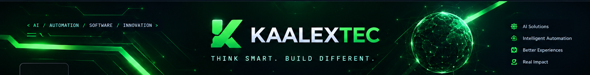

  

 

# 🟢 KAALEX

### BUILDING INTELLIGENCE. ENGINEERING THE FUTURE.

**Building intelligent AI-powered solutions for smarter businesses and better digital experiences.**

[Explore Our Projects](https://github.com/KaalexTec?tab=repositories)

---

## 🚀 About KaalexTec

We build intelligent, AI-powered solutions that help businesses automate workflows, enhance customer experiences, and solve real-world challenges through technology.

## 💡 What We Focus On

- Artificial Intelligence & Machine Learning
- Intelligent Automation
- AI-Powered Customer Experiences
- Modern Software Development

## 🛠️ Technology & Innovation

We work with modern technologies to build practical, scalable solutions. Explore our repositories to discover our projects and the tools behind them.

---

<h2 align="center">⚡ Our Technology Stack</h2>

  
  
  
  
  
  

### 🌱 Innovation starts with an idea.

**KAALEX — Think Smart. Build Different.**
<h2 align="center">📊 GitHub Activity</h2>

  
  

  

